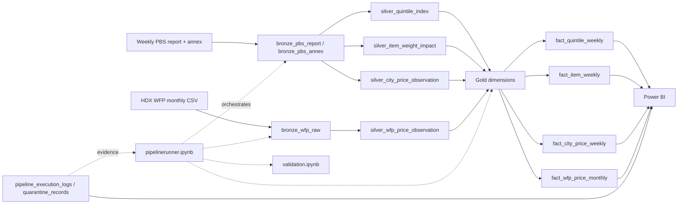

# SPI Inequality Pulse

A Databricks lakehouse and Power BI report for weekly household price pressure and quintile index differences in Pakistan, with monthly WFP market prices as volatility context.

## Current implementation

Production notebooks are in `notebooks/`. The pipeline has Bronze, Silver, and Gold layers, audit/quarantine tables, and validation code. Gold is a dimensional model consumed by the attached Power BI report. The attached PBIP is currently outside this repository at `C:/Users/MSi/Downloads/SPI_dashboard_final.pbip`; `docs/SPI_dashboard.pbix` contains report definitions matching all 44 report JSON files in that PBIP (six pages, 35 visuals). This comparison does not establish that the PBIX model data are current or all visuals render after refresh.

**Do not infer data coverage from model schema or report filters.** The PBIP configures six WFP countries (Afghanistan, Bangladesh, India, Iran, Pakistan, Sri Lanka), but actual loaded coverage must be verified:

```sql
SELECT country, COUNT(*) AS rows, MIN(price_date) AS first_date, MAX(price_date) AS last_date
FROM workspace.default.silver_wfp_price_observation
GROUP BY country ORDER BY country;
```

## DAG and orchestration



The runner sets up schemas and a shared batch ID, loads WFP Bronze/Silver, processes paired PBS report/annex weeks, refreshes Gold, then invokes validation. Logs and quarantine records provide operational traceability.

## Table inventory and logical grains

Types below reflect `notebooks/Schemas.ipynb`. Keys are logical merge/deduplication keys; Delta does not enforce primary-key uniqueness. All Gold tables include `load_timestamp`.

### Operations

| Table | Columns and types | Logical identifier |
|---|---|---|
| `pipeline_execution_logs` | `log_id STRING, batch_id STRING, load_type STRING, layer STRING, file_processed STRING, target_table STRING, start_time TIMESTAMP, end_time TIMESTAMP, status STRING, rows_read BIGINT, rows_inserted BIGINT, rows_updated BIGINT, rows_quarantined BIGINT, error_message STRING, message STRING` | `log_id` |
| `quarantine_records` | `quarantine_id STRING, batch_id STRING, layer STRING, source_file STRING, record_ref STRING, reason STRING, record_json STRING, quarantined_at TIMESTAMP` | `quarantine_id` |

### Bronze

| Table | Columns and types | Logical grain |
|---|---|---|
| `bronze_wfp_raw` | 18 source fields `adm0_id, adm0_name, adm1_id, adm1_name, mkt_id, mkt_name, cm_id, cm_name, cur_id, cur_name, pt_id, pt_name, um_id, um_name, mp_month, mp_year, mp_price, mp_commoditysource` all STRING; plus `extra_json, source_file, source_file_signature, batch_id, load_type STRING; load_timestamp TIMESTAMP` | File and market/commodity/price-type/unit/year/month identity |
| `bronze_pbs_report`, `bronze_pbs_annex` | `week_ending_date STRING, source_file STRING, sheet_name STRING, row_idx INT, c00..c24 STRING, extra_json STRING, batch_id STRING, load_type STRING, load_timestamp TIMESTAMP` | Week + sheet + row index |

WFP source values stay text in Bronze; unknown source fields are retained in `extra_json`. PBS workbooks are preserved as row grids because sheet layouts vary.

### Silver

| Table | Columns and types | Logical grain |
|---|---|---|
| `silver_wfp_price_observation` | `country STRING, admin_region STRING, market STRING, commodity_name STRING, category STRING, unit STRING, price_type STRING, price DOUBLE, currency STRING, price_date DATE, is_revised_flag BOOLEAN, ingestion_batch_id STRING, source_file STRING, load_timestamp TIMESTAMP, last_updated_timestamp TIMESTAMP` | Country + market + commodity + unit + price type + date |
| `silver_quintile_index` | `quintile STRING, income_band STRING, index_value DOUBLE, index_prev_week DOUBLE, index_prev_year DOUBLE, pct_change_wow DOUBLE, pct_change_yoy DOUBLE, week_ending_date DATE, source_file STRING, batch_id STRING, load_timestamp TIMESTAMP` | Week + quintile |
| `silver_item_weight_impact` | `week_ending_date DATE, item_name STRING, unit STRING, price_direction STRING, price_current DOUBLE, price_prev_week DOUBLE, price_prev_year DOUBLE, pct_change_wow DOUBLE, pct_change_yoy DOUBLE, weight_lowest DOUBLE, weight_combined DOUBLE, impact_lowest DOUBLE, impact_combined DOUBLE, source_file STRING, batch_id STRING, load_timestamp TIMESTAMP` | Week + item |
| `silver_city_price_observation` | `week_ending_date DATE, item_sl INT, item_name STRING, unit STRING, city STRING, city_code STRING, min_price DOUBLE, avg_price DOUBLE, max_price DOUBLE, price_dispersion_pct DOUBLE, source_file STRING, batch_id STRING, load_timestamp TIMESTAMP` | Week + item serial + city code |

Silver applies explicit casts, checks, deduplication and quarantine. PBS week refresh removes unmatched rows only for that target week. WFP Silver updates/inserts but does not currently reconcile source deletions.

### Gold dimensional model

| Table | Columns and types | Logical grain |
|---|---|---|
| `dim_date` | `date_key INT, full_date DATE, year INT, quarter INT, month INT, month_name STRING, year_month STRING, week_of_year INT, day_name STRING, load_timestamp TIMESTAMP` | Date |
| `dim_quintile` | `quintile_key INT, quintile STRING, income_band STRING, income_rank INT, weight_group STRING, load_timestamp TIMESTAMP` | Quintile |
| `dim_item` | `item_key INT, item_name STRING, unit STRING, item_group STRING, load_timestamp TIMESTAMP` | Item + unit |
| `dim_city` | `city_key INT, city STRING, city_code STRING, load_timestamp TIMESTAMP` | City code |
| `dim_market` | `market_key INT, country STRING, admin_region STRING, market STRING, load_timestamp TIMESTAMP` | Country + market |
| `dim_commodity` | `commodity_key INT, commodity_name STRING, unit STRING, category STRING, load_timestamp TIMESTAMP` | Commodity + unit |
| `fact_quintile_weekly` | `date_key INT, quintile_key INT, index_value DOUBLE, index_prev_week DOUBLE, index_prev_year DOUBLE, pct_change_wow DOUBLE, pct_change_yoy DOUBLE, index_vs_combined DOUBLE, load_timestamp TIMESTAMP` | Date + quintile |
| `fact_item_weekly` | `date_key INT, item_key INT, price_direction STRING, price_current DOUBLE, price_prev_week DOUBLE, price_prev_year DOUBLE, pct_change_wow DOUBLE, pct_change_yoy DOUBLE, weight_lowest DOUBLE, weight_combined DOUBLE, impact_lowest DOUBLE, impact_combined DOUBLE, load_timestamp TIMESTAMP` | Date + item |
| `fact_city_price_weekly` | `date_key INT, item_key INT, city_key INT, min_price DOUBLE, avg_price DOUBLE, max_price DOUBLE, price_dispersion_pct DOUBLE, avg_price_wow_pct DOUBLE, load_timestamp TIMESTAMP` | Date + item + city |
| `fact_wfp_price_monthly` | `date_key INT, market_key INT, commodity_key INT, price_type STRING, price DOUBLE, currency STRING, pct_change_mom DOUBLE, is_revised_flag BOOLEAN, load_timestamp TIMESTAMP` | Date + market + commodity + price type |

Surrogate integer keys are generated from hashes except date key (YYYYMMDD). Relationships: every fact joins `dim_date`; quintile fact joins `dim_quintile`; item and city facts join `dim_item`; city fact also joins `dim_city`; WFP fact joins `dim_market` and `dim_commodity`. Gold updates/inserts but has no general delete-not-matched reconciliation. Validation checks key uniqueness and orphans.

Gold creates a continuous calendar between observed dates, dimensions, and four facts. PBS facts can refresh all/none/selected weeks. WFP month-over-month change uses the previous observation and a default three-month Gold fact lookback.

## Runner, validation, and evidence

Production notebooks are under `notebooks/`; `localTestPlace/` is a staging copy. Its Gold notebook is older and misses production normalization of the “Gad Charges” typo to “Gas Charges”.

Runner defaults include `process_wfp=yes`, `process_pbs=yes`, `process_gold=yes`, `wfp_countries=Pakistan`, `lookback_months=3`, `reset_tables=no`, and `validation=yes`. Gold accepts `week_ending_dates=all|none|comma-separated dates` and `optimize_tables=yes|no`. WFP Bronze skips unchanged files by signature; runner incrementally skips PBS weeks already represented in all three Silver outputs.

Validation code checks table/timestamp presence, batch status, duplicate grains, value constraints, PBS quintile/item/city expectations, Gold keys/foreign keys/row counts, quarantine, and optional count-based idempotency. A check in source code is not evidence it passed in the latest run. Saved Gold output shows dimension processing and a WFP fact run; the validation notebook has no saved complete passing output. Capture a live run ID and validation results before claiming end-to-end success.

## Power BI report (6 pages, 35 visuals)

The attached final PBIP report definitions match the checked-in `docs/SPI_dashboard.pbix` definitions. This does not prove current model refresh or rendering.

| Page | What its visuals communicate |
|---|---|
| Who’s Hurting Most? | Quintile index line and latest-week bars, date slicer, latest gap/worst-hit cards and 4/12-week gap change/trend cards. “Worst hit” is the highest latest index level, not largest percentage change. |
| Regional Volatility Benchmark | Date range, Pakistan rank card, country volatility table/rank, 12-month trend and country bar chart. Six countries are configured; actual loaded coverage must be queried. |
| Fuel Impact & Pass-Through | Fuel and “Food & Other” weekly changes, lag 0–4 slicer, best-lag card, correlation chart, top-five fuel spikes. Correlation is not causality. |
| What Would Actually Help? | Q1 index, item weight/relief table, top-10 simulated Q1 drop, item and 0–100% subsidy cut slicers, scenario cards. It is not fiscal cost or cost-effectiveness. |
| Pipeline Health | Run counts by layer/status, quarantine card/reasons, failed-run details, run duration, inserted/updated trend. Needs populated audit records. |
| Local Volatility | City dispersion table and top-10 item volatility; city column chart sums avg_price over items/weeks, not an average city price or city SPI. |

The semantic model has six dimensions, four facts, two audit tables, a disconnected Lag 0–4 table, a subsidy parameter and 43 measures (42 in `_Measures (2)` plus the parameter measure). There is no city-level SPI index.

## Automation and data acquisition

- `.github/workflows/ingestion.yml` schedules Fridays at 12:00 UTC and supports manual dispatch. A workflow definition does not prove it ran.
- `src/fetch_wfp.py` calls HDX and writes the WFP CSV to a Databricks volume using configured secrets; live success is not evidenced here.
- `src/fetch_pbs.py` is a stub that creates a directory and prints status; it does not fetch/upload PBS files.
- `src/download_spi.py` is a separate local Playwright downloader, not called by that workflow.
- `src/common.py` has upload/retry helpers, but the WFP script does not import that helper.
- Notebook volume path: `/Volumes/workspace/default/spi_data/samples`.

## Scope limits and FinOps

The Phase 1 proposal mentions wage/affordability and cost-effectiveness, but current schemas/code contain no wage table, daily wage, affordability score or separate Gold burden/subsidy facts. Subsidy is a Power BI measure/what-if parameter. “Relief per 1% cut” is not monetary relief without price, quantity and expenditure data. City tables contain item price statistics, not a city SPI.

Incremental file/week skipping, targeted refresh, changed-value merges and a three-month WFP lookback can limit work, but savings have not been measured. Gold defaults to OPTIMIZE on all four facts after a run; disable it during debugging and optimize selectively based on actual table/query needs. No usage, spend, GitHub plan/visibility or Power BI licensing data were supplied, so no dollar estimate is supported. Databricks Free Edition is serverless and quota-limited; GitHub Actions cost depends on plan and repository visibility.

## Repository map

- `notebooks/Schemas.ipynb`: explicit table definitions.
- `notebooks/bronze*.ipynb`, `silver*.ipynb`: source ingestion and typed transformations.
- `notebooks/gold.ipynb`: production dimensions and facts.
- `notebooks/pipelinerunner.ipynb`, `validation.ipynb`: orchestration and checks.
- `notebooks/Tables.ipynb`: SQL inspection.
- `docs/SPI_dashboard.pbix`: checked-in report artifact.
- `docs/SPI_Inequality_Pulse_Phase1.docx`: original proposal, not proof of delivered scope.
- `context.md`: working context; verify against canonical notebooks.

## FinOps references

- [Databricks Free Edition limitations](https://docs.databricks.com/aws/en/getting-started/free-edition-limitations)
- [GitHub Actions billing](https://docs.github.com/en/billing/concepts/product-billing/github-actions)
